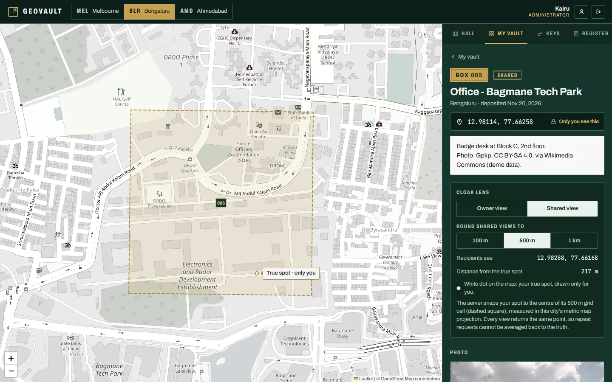
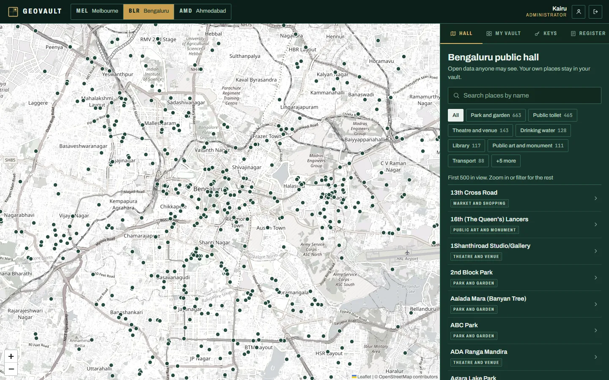
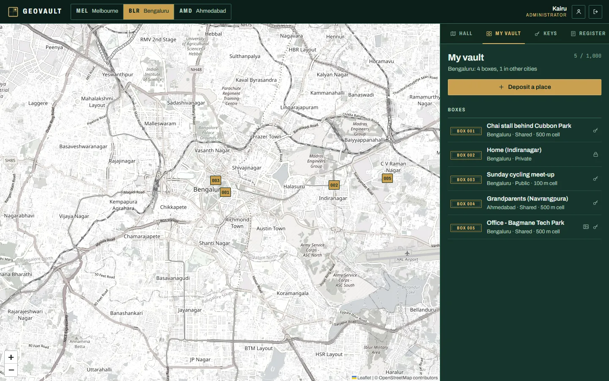
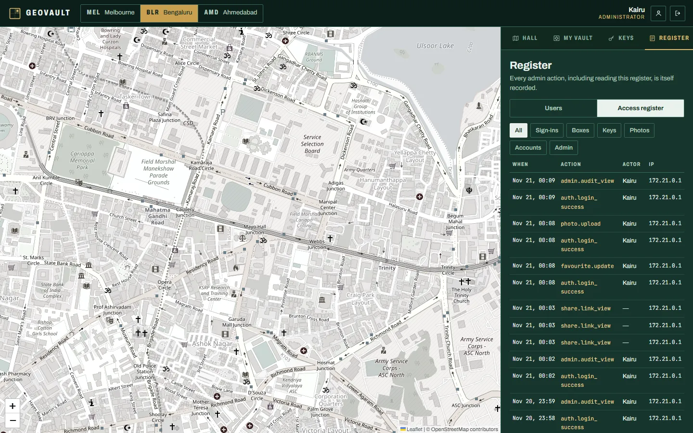
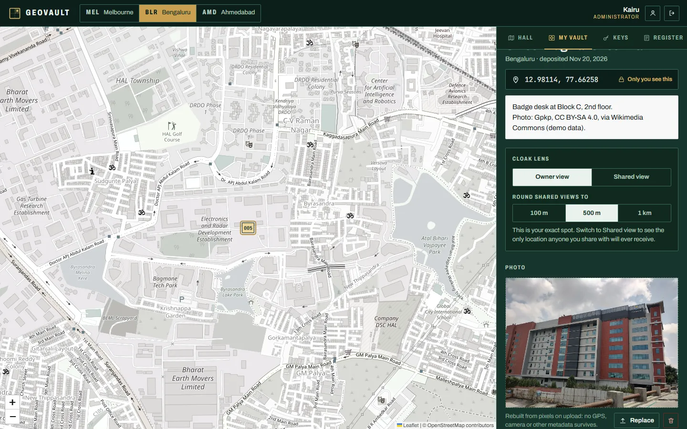
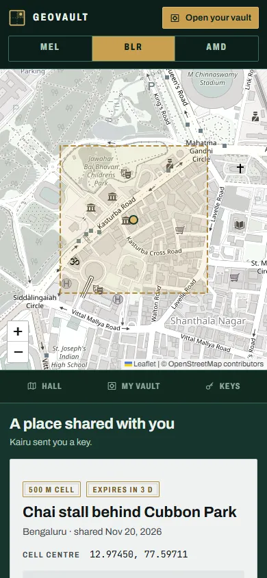

# GeoVault

[](https://github.com/dragonday3/geovault/actions/workflows/ci.yml)

A multi-region geospatial web application built on public open data for **Melbourne, Australia**,
**Bengaluru, India** and **Ahmedabad, India**, developed as a security portfolio project: build it, threat-model it,
attack a deliberately vulnerable **local lab** instance, remediate, and prove the fixes with
regression tests.

> **Status: Milestone 13 — threat model and test plan.** 3,295 real places across three cities;
> accounts, private favourites, cloaked sharing, photos, admin, GeoServer, CI and the full UI are
> built (see `CHANGELOG.md`). **Lab mode (milestone 11) is not built yet.** Only features listed
> under *What works now* are implemented. New here? Read the **[project guide](docs/project-guide.md)**.

## Interface

GeoVault's interface is a **safe-deposit hall**. The city map is the public hall. Your places
are numbered private boxes. A share is a key with a stamped expiry, and the audit trail is the
access register. The signature interaction is the **cloak lens**: switch a box to *Shared
view* and its plate slides from your exact spot into the server-computed grid cell, which is
the only location anyone you share with ever receives.

| | |
|---|---|
|  |  |
| *Cloak lens (Shared view): recipients see the cell centre, 217 m from the true spot* | *Public hall: open data, category plates, city-clamped map* |
|  |  |
| *My vault: numbered boxes, capacity printed on the furniture* | *Access register (admin): secret-free audit trail* |
|  |  |
| *Photo stored metadata-free (demo photo: Gpkp, CC BY-SA 4.0, via Wikimedia Commons)* | *Anyone with a link sees a 500 m cell, never the exact spot* |

Built in vanilla JS (ES modules) with vendored Leaflet and self-hosted Archivo and JetBrains
Mono (SIL OFL), under the strict CSP: no inline script or style, no third-party origins
except OSM tiles. API data reaches the page only through `textContent`. The access token lives
only in module memory, never in `localStorage`. Share links put the token in the URL
**fragment** (`/#/share/<token>`), which browsers never send to the server. Design system:
[DESIGN.md](DESIGN.md). Product brief: [PRODUCT.md](PRODUCT.md).

## What works now

| Endpoint | Purpose |
|---|---|
| `GET /api/health` | API + database health (`503` if the DB is unreachable) |
| `GET /api/regions` | Supported regions with bounds, centre and zoom limits |
| `GET /api/sources` | Dataset provenance, licence and attribution; optional `region` |
| `GET /api/categories` | Place categories with counts; optional `region` |
| `GET /api/places` | Filter by `region`, `category`, name search `q`, `bbox=minLon,minLat,maxLon,maxLat`; `limit` ≤ 500 |
| `GET /api/places/near` | `lat`, `lon`, `radius_m` ≤ 5000, `limit` ≤ 100, optional `region`/`category`; nearest first with `distance_m` |
| `GET /api/places/{id}` | Single place |
| `GET /` | Leaflet map UI: region switcher, search, category filters, click-to-search nearby, data attributions |
| `POST /api/auth/register` | Create account (≥12-char, breach-checked password). Always `202` with a generic message, so it is not an enumeration oracle |
| `POST /api/auth/login` | 15-min access token in the body; rotating refresh token in an HttpOnly cookie; rate-limited |
| `POST /api/auth/refresh` | Rotate refresh token (cookie + `X-CSRF-Token`); reuse of an old token revokes the session |
| `POST /api/auth/logout` | Revoke the session and clear cookies (requires `X-CSRF-Token`) |
| `GET /api/users/me` | The authenticated user's profile (`Authorization: Bearer`) |
| `PATCH /api/users/me` | Change display name. Any other field (e.g. `role`) is rejected with 422 |
| `GET /api/users/me/export` | Download everything GeoVault holds about you as JSON |
| `DELETE /api/users/me` | Delete your account (password re-entry required): content erased, identity anonymised |
| `GET/POST /api/favourites` | List your favourites / save one (by `location` or public `place_id`; region derived server-side) |
| `GET/PATCH/DELETE /api/favourites/{id}` | Owner only: exact location and private note. Anyone else gets 404 |
| `GET /api/favourites/{id}/cloak-preview` | Owner only: the exact point and grid cell recipients would get at 100 m / 500 m / 1 km (powers the cloak lens) |
| `GET /api/favourites/public` | Favourites marked public: cloaked location and display name only |
| `POST /api/favourites/{id}/share` | Share with a registered user (`{"type":"user","email":...}`) or create an expiring link (`{"type":"link","expires_in_hours":72}`) |
| `GET /api/favourites/{id}/shares`, `DELETE .../shares/{share_id}` | List / revoke shares |
| `GET /api/shared/{token}` | Anonymous link view: cloaked location (100 m / 500 m / 1 km grid), no note, email or place |
| `GET /api/shared/with-me` | Favourites shared with you (cloaked) |
| `POST/GET/DELETE /api/favourites/{id}/photo` | Owner: upload (JPEG/PNG/WebP ≤ 5 MB, multipart field `file`), view, remove. Uploads are rebuilt from pixels with all EXIF/GPS removed |
| `GET /api/shared/{token}/photo`, `GET /api/shared/with-me/{share_id}/photo` | Photo for a valid share link / your received share |
| `GET /api/admin/users` | Admin: search/list accounts |
| `PATCH /api/admin/users/{id}/role` | Admin: grant/revoke admin (not your own role); audited |
| `GET /api/admin/audit` | Admin: audit trail with filters (viewing it is itself audited) |
| `GET /docs` | OpenAPI docs (local environment only; disabled when `GEOVAULT_ENV=production`) |

Responses are GeoJSON with explicit response schemas.

## Stack

PostgreSQL 16 + PostGIS 3.5 · FastAPI · Psycopg 3 · Python 3.12 · Leaflet 1.9.4 (vendored) · Docker Compose

## Quick start

Prerequisites: Docker Desktop.

```powershell
# 1. Create your local secrets file (gitignored) and put strong random values in it
Copy-Item .env.example .env
py -3.10 -c "import secrets; print(secrets.token_urlsafe(48))"   # run 3x: two DB passwords + JWT secret

# 2. Start the stack (first run builds the API image and initialises the database)
docker compose up -d --build
docker compose ps            # api and db should both show (healthy)

# 3. Import the committed open-data snapshots (offline: reads data/raw/, verifies SHA-256)
docker compose run --rm -v ./data:/srv/data:ro api python /srv/data/import_sources.py
```

macOS/Linux: use `cp .env.example .env` and `python3 -c ...`; the other commands are identical.

Open <http://127.0.0.1:8000> (or the port set in `GEOVAULT_API_PORT`).

```powershell
curl.exe -s http://127.0.0.1:8000/api/health
# {"status":"ok","db":"ok"}
curl.exe -s "http://127.0.0.1:8000/api/places/near?lat=-37.8136&lon=144.9631&radius_m=1000&limit=5"
```

Create the first administrator (operator-only; there is deliberately no HTTP route for it):

```powershell
docker compose exec api python -m app.manage promote-admin you@example.com
```

**GeoServer (optional, WMS/WFS for GIS clients):** `docker compose --profile geoserver up -d geoserver`,
then `py -3.10 geoserver/bootstrap.py` and `py -3.10 geoserver/verify.py`. Only the public places
layer is published, through a read-only DB role that cannot see private tables. Details and
verification: **[docs/geoserver.md](docs/geoserver.md)**.

**Troubleshooting**

- `port is already allocated` → another service uses 8000; set `GEOVAULT_API_PORT=8010` in `.env`.
- `set POSTGRES_PASSWORD in .env` → you skipped step 1.
- Changed DB passwords after the first run? The DB is initialised once per volume:
  `docker compose down -v` (**deletes local data**) then start again.

## Testing

```powershell
docker compose -f compose.test.yml run --rm --build test   # 295 tests, ~45 s after the image is built
docker compose -f compose.test.yml down -v                 # remove the throwaway test database
```

The suite runs against a real PostGIS database, not mocks, because the properties under test
only exist there: bound parameters, constraints, triggers and role privileges. The database is
in-memory (tmpfs) and lives in a **separate compose project** (`geovault-test`), so tearing it
down can never touch the dev database. `tests/conftest.py` also refuses to run against any
database host other than the dedicated test instance.

| Area | What is verified |
|---|---|
| API behaviour | regions, categories, search, bbox, nearest-first ordering, 404s |
| Input validation / API4 | radius, limit, offset, query length, bbox shape, coordinate range, region pattern → 422 |
| SQL injection | classic, stacked-query and UNION payloads in `category` and `q` are inert (200, no rows, nothing dropped) |
| Database | app role is not superuser and cannot read server files; region-bounds trigger; unique keys; migrations idempotent; malicious migration filenames refused |
| Data integrity | tampered snapshot refused with DB untouched; provenance recorded; idempotent re-import; stale rows pruned |
| Adapters | private dwellings/offices excluded; shared category vocabulary; stable ids; OSM mapping |
| Authentication | password policy, generic failures, Argon2 timing parity, rate limits, hardened cookies, `alg=none`/forged/expired/wrong-audience JWTs rejected, role claim ignored, refresh rotation + reuse detection, logout revocation, hashed token storage, secret-free audit |
| Schema constraints | share must target exactly one user or an expiring link; photos must be EXIF-stripped with server-generated keys; favourites stay in-region without leaking coordinates; deleting a user cascades private data but keeps anonymised audit rows |
| Accounts | display-name-only edits (role/email/id smuggling → 422), export contains only your data and no secrets, deletion needs the password, erases content, anonymises identity, keeps audit evidence, frees the email; last admin cannot delete themselves |
| Favourites / BOLA (API1) | another user gets 404, identical to a missing id, on read, edit, delete, share, list-shares and revoke, and the data is unchanged; region server-derived; owner_id/region smuggling → 422; per-user cap |
| Sharing / data exposure (API3) | shared and public views contain exactly the minimal fields; cloaked within half a cell diagonal at 100/500/1000 m; deterministic (no averaging); linked place never revealed; tokens shown once and stored hashed; revoked, expired, now-private and deleted-owner links → 404; share validation, self/duplicate shares, rate limit |
| Photos | GPS/camera/XMP/PNG-text metadata gone from the downloaded file (fixtures proven to contain it first); orientation preserved; SVG/HTML/GIF/truncated files and decompression bombs → 422; > 5 MB → 413 and no length → 411, before the body is parsed; filename and content type ignored; safe delivery headers; owner, link and recipient access scoped; replace/delete/account deletion remove files |
| Admin (API5) | anonymous → 401 and ordinary user → 403 on every admin route; router-level guard asserted; role change is immediate and audited; no self role change; audit view filtered and self-audited |
| Hardening (API8) | CSP (no `unsafe-inline`/`eval`, `frame-ancestors 'none'`), nosniff, X-Frame-Options, Referrer/Permissions/COOP/CORP on every response incl. 404/401/500; route CSP preserved; relaxed CSP only on local `/docs`; HSTS only in production; no CORS for foreign origins; no server banner |
| Errors and logging | unhandled exceptions → generic JSON 500 with request ID, no traceback; request IDs validated; JSON logs redact JWTs, bearer tokens, passwords, emails, DSNs, share tokens and coordinates; access log has no query strings; full user journey leaves no secrets in logs |
| Frontend (static) | every module free of `innerHTML`/`eval`/`document.write`/`localStorage`; relative imports resolve; no inline scripts, styles or handlers; Leaflet SRI intact; fonts self-hosted with OFL licences |
| GeoServer DB role | `geoserver_ro` is unprivileged, reads only `public_places` public columns, is denied on every private table, read-only, single grant |
| Docs | `/docs` and `/openapi.json` return 404 in production |

**CI** (`.github/workflows/ci.yml`, on every push and PR) runs ruff, the test suite,
Gitleaks over the full history, pip-audit, a Trivy image scan (fails on fixable
HIGH/CRITICAL) and a Trivy config scan. Actions are pinned to commit SHAs, scanner images
are pinned by digest, and the workflow token is read-only. **Pre-commit** runs ruff,
Gitleaks, private-key detection and file hygiene before every local commit:
`py -3.10 -m pip install pre-commit` then `py -3.10 -m pre_commit install`.

## Security assessment

- **[Threat model](docs/threat-model.md):** STRIDE per element over a data-flow diagram with
  nine trust boundaries, an attack-surface inventory, abuse cases, OWASP API Top 10 (2023)
  coverage and accepted residual risks. Every control cites the automated test that proves it.
- **[Test plan](docs/test-plan.md):** WSTG v4.2 and API Top 10 methodology for an authorised,
  localhost-only assessment. It sets out scope and rules of engagement (no third-party
  infrastructure), test cases traced to the threat model, CVSS v3.1 scoring and the finding
  template.

## Security design (implemented so far)

- **Network exposure:** the API is published on `127.0.0.1` only; the database has no published port.
- **Least-privilege database role:** the API connects as `geovault_app` (not superuser, cannot create
  roles, cannot read server files). PostGIS is installed by the superuser at init time.
- **SQL injection:** every value is a bound parameter. Optional filters use
  `(%(x)s IS NULL OR col = %(x)s)` and dynamic `UPDATE`s use `psycopg.sql` identifiers from an
  allowlist. Ruff's bandit rules (`S608`) run on all code; the few suppressions are annotated
  inline and only interpolate module constants (column lists), never request data.
- **Resource limits (OWASP API4):** radius, result-count, offset and input-length caps; a 5 s
  `statement_timeout` on every DB connection.
- **HTTP hardening:** strict CSP (self-hosted scripts, no inline code, only OSM tiles as a
  third-party image source, `frame-ancestors 'none'`), `nosniff`, `X-Frame-Options: DENY`,
  Referrer, Permissions, COOP and CORP policies, `no-store` on API responses, and HSTS in
  production. No CORS (same-origin UI). Uvicorn's server banner is disabled.
- **Errors and logging:** one middleware turns any unhandled exception into a generic JSON 500
  with a request ID; the traceback goes only to the server log. Logs are one JSON object per
  line with a request ID, and every string is scrubbed of JWTs, bearer tokens, password/secret
  fields, emails, DB DSNs, share tokens and coordinates. Uvicorn's raw access log is replaced
  by one that omits query strings (search locations).
- **Container hardening:** non-root user (uid 10001), read-only root filesystem, all Linux
  capabilities dropped, `no-new-privileges`, base images pinned by digest, Debian security
  updates applied at build, health checks. Test tooling lives in a separate `test` build stage
  and never ships in the runtime image.
- **Frontend:** API data is rendered with `textContent` only (no `innerHTML`); Leaflet is self-hosted
  and pinned with Subresource Integrity hashes.
- **Authentication:** Argon2id, NIST-style password policy with a 30k breached-password list,
  per-account and per-IP rate limiting, no user enumeration (generic errors plus constant-time
  path), HS256 JWTs with pinned algorithm and required claims, role read from the DB not the
  token, and refresh-token rotation with reuse detection. Design and trade-offs:
  **[docs/authentication.md](docs/authentication.md)**.
- **Authorization:** identity always comes from the token, and there is no user id in any
  self-service route. Admin routes are guarded at router level by a role check read from the DB.
  Request models forbid unknown fields (mass assignment). Personal and admin responses are
  `Cache-Control: no-store`.
- **Location privacy:** exact coordinates only ever reach the owner. Every other view is snapped
  in SQL to a 100 m / 500 m / 1 km grid in the city's metric projection, with no note, email or
  linked place. See **[docs/privacy/location-precision.md](docs/privacy/location-precision.md)**.
- **Photos:** decoded and rebuilt from raw pixels, so EXIF/GPS, XMP, ICC and text chunks are
  dropped as a class. Format comes from content, not the client. Decompression-bomb and size
  limits apply before decoding/parsing. Files get random keys in a dedicated volume and are
  served with `nosniff` + sandbox CSP. See **[docs/privacy/photo-handling.md](docs/privacy/photo-handling.md)**.
- **Data rights:** JSON export of all personal data. Account deletion erases content,
  anonymises the account row and retains de-identified audit evidence.
- **Audit log:** registration, login success/failure, rate limiting, refresh, reuse detection,
  logout, profile changes, export, deletion, role changes and audit viewing are recorded
  without passwords, tokens or attempted email addresses.
- **Secrets:** read from environment (`.env`, gitignored); the DB DSN is a `SecretStr` so it never
  appears in logs or reprs.

## Regions and data

| Region | Country | Projected CRS (precision cloaking) | Data | Places |
|---|---|---|---|---|
| `melbourne` | AU | EPSG:7855 GDA2020 / MGA 55 | City of Melbourne Open Data — 5 datasets (CC BY 4.0) | 925 |
| `bengaluru` | IN | EPSG:32643 WGS 84 / UTM 43N | OpenStreetMap extract (ODbL 1.0); Indian government datasets can be added | 1,995 |
| `ahmedabad` | IN | EPSG:32643 WGS 84 / UTM 43N | OpenStreetMap extract (ODbL 1.0) | 375 |

Datasets are snapshotted once into `data/raw/` with a SHA-256 manifest and imported offline,
so the app never calls third-party services at runtime. All sources map into one shared
category list. Region bounds are enforced in the database by a trigger, so no writer can
bypass them. Full provenance, exclusions (e.g. private dwellings), known gaps and how to add
data.gov.in / OpenCity files: **[docs/data-sources.md](docs/data-sources.md)**.

**Map boundaries (India).** Each region's map is clamped to its city bounds at a minimum zoom, so
national and international boundaries are never rendered. This avoids depicting India's borders
differently from the official Survey of India depiction.

**ISRO Bhuvan.** Bhuvan's terms grant a view-only, single-user licence, so its tiles are not
embedded. Places in the Indian cities (Bengaluru, Ahmedabad) link out to Bhuvan 2D with a copy-coordinates helper instead.

## Project layout

```
app/            FastAPI application (config, database pool, migrations runner, routers, schemas)
db/init/        one-time database bootstrap (least-privilege app role)
db/migrations/  numbered SQL migrations, applied automatically at API start-up
data/           dataset catalogue (sources.py), fetcher, importer, raw snapshots, test seeds
docs/           threat model, test plan, data sources, authentication, GeoServer, privacy
frontend/       the hall UI: index.html, styles.css, icons.svg, js/ (api, dom, map, views/*), vendored Leaflet + fonts
tests/          unit + integration tests (real PostGIS)
compose.test.yml  isolated test stack (separate compose project)
geoserver/      REST bootstrap and verification scripts for the GeoServer profile
.github/        CI workflow and Dependabot configuration
```

## Scope and ethics

Security testing in this project targets **only** GeoVault instances owned by the developer on
localhost or the developer's own AWS account. No City of Melbourne, Government of India / data.gov.in,
ISRO Bhuvan, OpenStreetMap or other third-party infrastructure is ever scanned or tested.

Fonts: Archivo (Omnibus-Type) and JetBrains Mono, SIL Open Font License 1.1 (licences in
`frontend/vendor/fonts/`). Map tiles and Bengaluru/Ahmedabad place data © OpenStreetMap contributors (ODbL). Melbourne place data
© City of Melbourne (CC BY 4.0).
