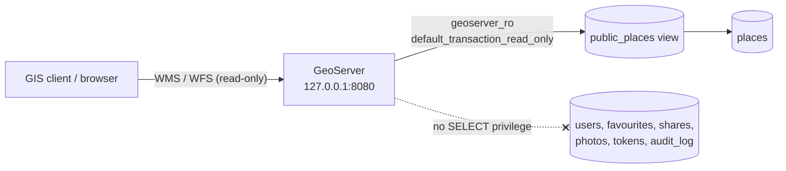

# GeoServer: public places over WMS/WFS

GeoServer publishes **only** the public places dataset as OGC services (WMS map images and
WFS features) for GIS clients such as QGIS. It runs locally as an opt-in compose profile on
`127.0.0.1:8080`.

## Defence in depth



| Layer | Control |
|---|---|
| Database | `geoserver_ro` has `SELECT` on the `public_places` view **only**: not even on the base `places` table. Its transactions are read-only, and statements time out after 15 s. It is not a superuser and cannot create roles or databases. |
| View | `public_places` exposes `id, name, category, region, source, geom`, nothing else. |
| GeoServer | One workspace, one store, one published layer. WFS service level is `BASIC` (no Transaction operations). WCS is disabled and the demo data is skipped. |
| Credentials | The admin password is **mandatory** (`GEOSERVER_ADMIN_PASSWORD` in `.env`). Without it the image would use the well-known `admin`/`geoserver`. |
| Network | Port published on `127.0.0.1` only. CORS is off. |
| Container | Image pinned by digest. Tomcat runs unprivileged (uid 999) with `cap_drop: ALL` plus only the capabilities needed to drop privileges, and `no-new-privileges`. |

The database layer is what makes this robust. In the verification below, an administrator
deliberately publishes the private `favourites` table through GeoServer, and the layer still
returns no data because the database refuses the read.

## Run

```powershell
# 1. Add GEOSERVER_ADMIN_PASSWORD and GEOVAULT_GEOSERVER_DB_PASSWORD to .env (see .env.example)
# 2. Existing database volume only (new volumes do this automatically at first start):
docker compose up -d db
docker compose exec -T db sh /docker-entrypoint-initdb.d/30_geoserver_role.sh
docker compose up -d --build api            # applies migration 0010 (the public_places view)
# 3. Start GeoServer and configure it
docker compose --profile geoserver up -d geoserver
py -3.10 geoserver/bootstrap.py
py -3.10 geoserver/verify.py
```

macOS/Linux: identical, using `python3` instead of `py -3.10`. In Git Bash on Windows, prefix
the `exec` line with `MSYS_NO_PATHCONV=1` so the container path is not rewritten.

**Never** run `docker compose --profile geoserver down -v`: `-v` also deletes the dev database
volume. Stop GeoServer with `docker compose stop geoserver`.

## What `verify.py` checks (all PASS on the reference run)

| Check | Expected |
|---|---|
| Default `admin`/`geoserver` and anonymous REST | 401 |
| WFS and WMS GetCapabilities | only `geovault:public_places` |
| WFS GetFeature on `public_places` | features with `id, name, category, region, source` only |
| WMS GetMap | PNG rendered |
| WFS GetFeature on `favourites`, `users`, `shares`, `photos`, `refresh_tokens`, `audit_log` | `ExceptionReport` |
| WFS Transaction (delete) | rejected |
| Admin publishes `favourites` via REST | layer returns no data (DB denies `SELECT`); the layer is removed again |
| Port from the LAN address | not reachable |

## Manual spot checks

```powershell
# WFS: list published feature types (expect only geovault:public_places)
curl.exe -s "http://127.0.0.1:8080/geoserver/ows?service=WFS&version=2.0.0&request=GetCapabilities" | Select-String "<wfs:Name>"
# WFS: three public places as GeoJSON
curl.exe -s "http://127.0.0.1:8080/geoserver/ows?service=WFS&version=2.0.0&request=GetFeature&typeNames=geovault:public_places&count=3&outputFormat=application/json"
# WFS: a private table (expect an ExceptionReport)
curl.exe -s "http://127.0.0.1:8080/geoserver/ows?service=WFS&version=2.0.0&request=GetFeature&typeNames=geovault:favourites&count=1"
# Database: the role cannot read private tables (expect "permission denied")
docker compose exec -T -e PGPASSWORD=<geoserver db password> db psql -h 127.0.0.1 -U geoserver_ro -d geovault -c "select * from users limit 1"
```

In QGIS: *Layer → Add Layer → Add WFS Layer*, URL `http://127.0.0.1:8080/geoserver/ows`.

## Automated tests

`tests/integration/test_geoserver_role.py` runs in CI against the test database:
- the role is unprivileged;
- it can read only the view's public columns;
- `permission denied` on every private table;
- read-only transactions;
- its only grant is `SELECT` on `public_places`.

Widening the grant to all tables makes 9 of these tests fail (mutation-checked).
