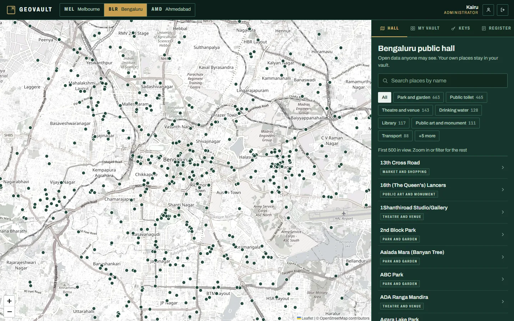
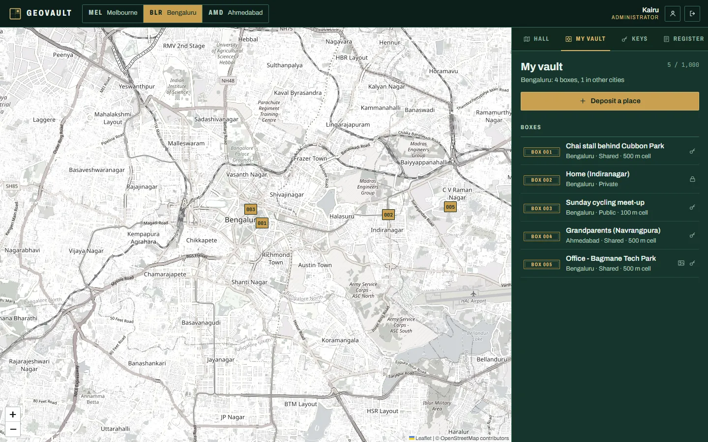
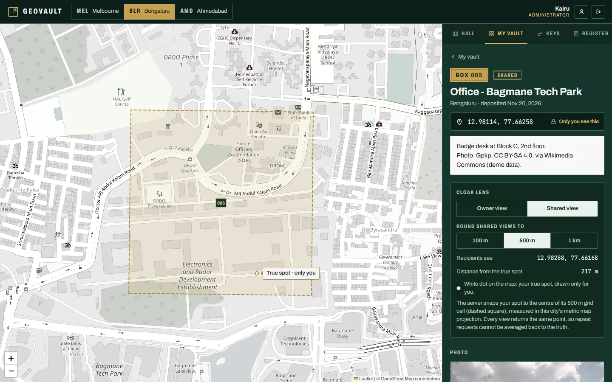
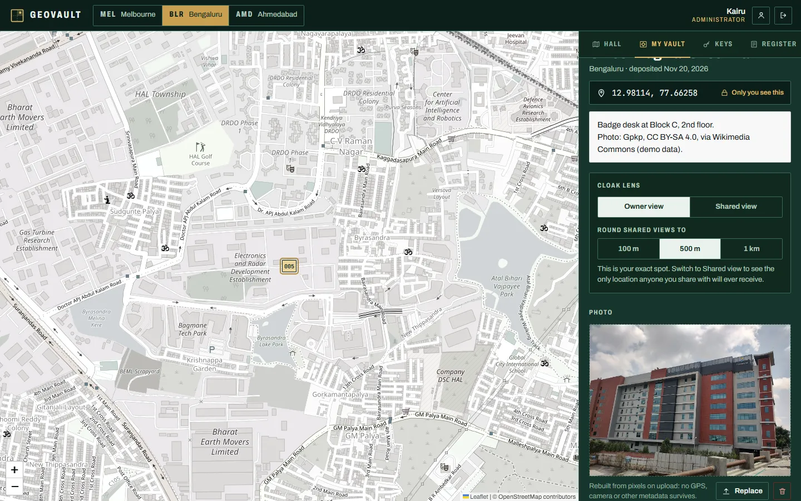
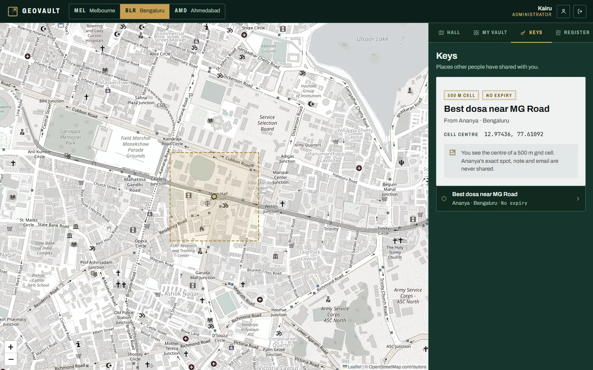
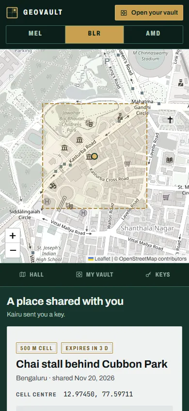
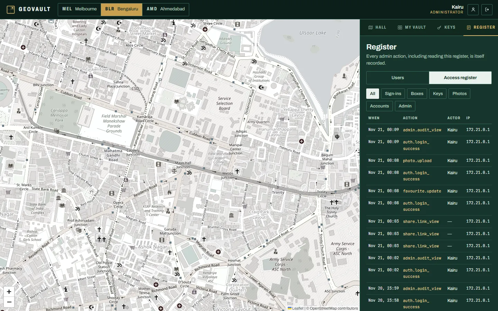
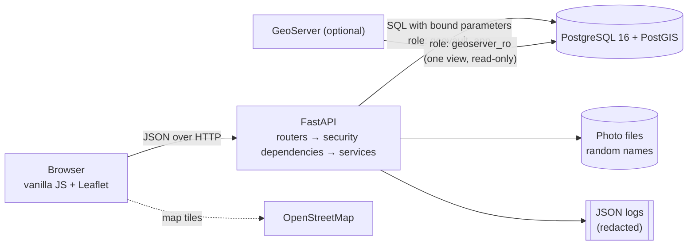

# GeoVault: the complete guide

This guide explains what GeoVault is, how to use every screen, how it works underneath, which
skills and knowledge went into it, and how to explain each piece in an interview. Read it top
to bottom once, then use it as a reference.

---

## 1. What GeoVault is, in one minute

GeoVault is a map app for three cities: **Melbourne, Bengaluru and Ahmedabad**. Anyone can
explore about 3,300 real public places (parks, libraries, metro stations, EV chargers, toilets
and more) from official open data and OpenStreetMap. Signed-in users keep a private **vault**
of their own places, such as home, office or a favourite chai stall. Each place has an exact
location, a private note and a photo, and can be shared with friends **without revealing the
exact spot**.

It is also a **security portfolio** built in three projects:

| Project | Question it answers | Status |
|---|---|---|
| 1. Application security | Can I build an app, attack it, fix it and prove the fixes? | App, tests, threat model, test plan and GeoServer are done. The lab mode (M11) and the manual pentest report are next. |
| 2. Cloud security | Can I deploy it securely on AWS and audit it? | Next (repo `geovault-infra`) |
| 3. Privacy / GRC | Can I assess it against Australian and Indian privacy law and measure the privacy risk? | Planned |

The one-sentence pitch: *"I built a geospatial app where privacy is the product. Your exact
location never leaves you, every security claim has a test that proves it, and I can show you
how each control stops a real attack."*

---

## 2. Open it

```powershell
cd D:\Kairu\geovault
docker compose up -d          # starts the database and the API (add --profile geoserver for GeoServer)
start http://127.0.0.1:8010   # opens the app
```

- **Create an account:** click **Open your vault**, then **Create a vault**. Use any
  `name@example.com` address and a 12+ character passphrase that is not a common password.
- **Become an administrator** (needed for the Register tab):
  `docker compose exec api sh -c 'exec $0 -m app.manage promote-admin "$1"' python3 you@example.com`
  Then sign out and in again.
- API documentation (local only): `http://127.0.0.1:8010/docs`.
- GeoServer (if started): `http://127.0.0.1:8080/geoserver`.

---

## 3. Tour: what each screen shows and how to use it

The layout is always the same: a **map** on the left, and a dark-green **rail** (side panel) on
the right with tabs. On a phone, the map sits on top and the rail below it.

### 3.1 The header

- **GeoVault wordmark:** returns to the Hall.
- **City plates `MEL / BLR / AMD`:** switch city. The map is *locked* to that city at city zoom,
  so India's national borders never appear (a Survey of India sensitivity).
- **Right side:** "Open your vault" when signed out. When signed in, it shows your name and role,
  plus account and sign-out buttons.

### 3.2 Hall: the public explorer



What it shows: every public place in the visible part of the map, as green dots, with a list in
the rail.

How to use it:
- **Search** by name. The list follows the map, so pan or zoom to change what is shown.
- **Category chips** filter by type (Park and garden, Library, Transport…), with counts.
- **Click a place** (on the map or in the list) to open its card. The card shows the
  coordinates, the data source and licence, and these actions:
  - **Deposit in my vault** saves this place privately.
  - **Nearby** lists places within 250 m–5 km, sorted by distance.
  - **Open Bhuvan 2D** and **Copy coordinates** appear in Indian cities only. They link out
    to ISRO's portal; Bhuvan's terms don't allow embedding its tiles.
- At the bottom, **Data sources** lists every dataset and its required attribution.

### 3.3 Sign in / Create a vault

Explains the three protections in plain words. Errors are deliberately vague ("Invalid email or
password"), so nobody can find out which emails have accounts.

### 3.4 My vault: your private boxes



What it shows: your places as **numbered boxes** (Box 001, 002…, in the order you deposited
them), as brass plates on the map and a list in the rail. The counter in the corner ("5 / 1,000")
is your allowance.

How to use it:
- **Deposit a place:** click the brass button, then **click the map** where the place is. Fill in:
  - the label;
  - a private note;
  - the visibility: **Private** (only you), **Shared** (people you give a key to) or **Public**
    (all signed-in users, location rounded);
  - how much to round the location when shared: 100 m, 500 m or 1 km.

  Or open a public place in the Hall and press *Deposit in my vault*.
- Click a box to open it.

### 3.5 An opened box: the heart of GeoVault



What it shows:
- **Exact coordinates**, marked *Only you see this*, and your private note.
- **The cloak lens** (the signature feature). Switch **Owner view** to **Shared view**: the box
  slides from your exact spot into a **dashed square**. That square is the grid cell computed by
  the server, and its centre is the *only* location anyone you share with will ever receive. The
  panel shows the recipient's coordinates and the distance from the truth (for example 217 m).
  The small white dot labelled *True spot · only you* is drawn only for you.
- **Round shared views to** changes the precision: 100 m, 500 m or 1 km.
- **Photo:** upload a JPEG, PNG or WebP up to 5 MB. It is rebuilt from pixels on upload, so GPS
  and camera metadata are gone.
- **Keys:** the shares you issued, each as a tag with a stamped expiry. Revoke any key instantly.
  **Issue a key** either to a registered user (by their email) or as an **expiring link**
  (1 hour to 30 days). A link is shown **once**; copy it then.
- **Visibility** and **Details** (edit the label or note), and a separate **Delete this box**.



### 3.6 Keys: places shared with you



Each key you received shows who shared it, the expiry and the precision. Opening one draws the
rounded cell on the map; you never get the exact spot, the note or the owner's email.

### 3.7 A share link (no account needed)



Anyone with a link sees the label, the owner's display name, the rounded cell and the photo (if
any), with a note explaining that the exact spot is never shared. Expired, revoked or
now-private links say *"This key no longer opens anything"*.

### 3.8 Account

- Change your display name, the only identity sharers see.
- **Export my data** downloads a JSON file of everything GeoVault holds about you.
- **Delete my account** asks for your password. It erases your boxes, notes, photos and keys,
  anonymises your account, and keeps de-identified security records.

### 3.9 Register (administrators only)



- **Users:** search accounts and grant or remove the admin role (never your own). Changes take
  effect on the user's very next request.
- **Access register:** the audit log. It shows sign-ins, failures, keys issued, uploads,
  deletions and role changes, with filters. Reading the register is itself recorded. Destructive
  and suspicious actions show in red.

### 3.10 GeoServer (for GIS tools)

With the profile running, QGIS or any WMS/WFS client can load the layer
`geovault:public_places` from `http://127.0.0.1:8080/geoserver/ows`. That layer is the only
thing published: see [geoserver.md](geoserver.md).

---

## 4. How it works underneath



| Layer | What it is | Where |
|---|---|---|
| Database | PostgreSQL 16 + PostGIS 3.5. Ten numbered SQL migrations create the tables, constraints, triggers, the cloaking function and the GeoServer view. | `db/migrations/` |
| API | FastAPI (Python 3.12). Each request flows through **routers**, then **dependencies** (who are you? may you touch this?), then **services** (the SQL). | `app/` |
| Frontend | Plain JavaScript modules (no framework), Leaflet for the map, a hash router (`#/vault/…`). Fonts and Leaflet are served from our own server. | `frontend/` |
| Data | One-time snapshots of open data, checksummed, imported offline. | `data/` |
| GeoServer | Optional OGC map server for GIS tools. | `geoserver/`, `docker-compose.yml` |
| Tests and CI | 295 tests against a real database, plus five CI jobs on every push. | `tests/`, `.github/workflows/ci.yml` |

**Life of a request,** for example opening Box 005:
1. The browser sends `GET /api/favourites/<id>` with `Authorization: Bearer <access token>`.
2. `get_current_user` checks the token's signature and expiry, then loads the user from the
   database (so a deleted user or a changed role takes effect immediately).
3. `get_owned_favourite` runs `WHERE id = … AND owner_id = <you>`. For anyone else it returns
   **404**, exactly as if the box did not exist.
4. The service runs a parameterised SQL query and returns the owner view (exact coordinates and note).
5. Middleware adds the security headers and a request ID, and writes a redacted log line.

**How cloaking works:**
1. The exact point is projected into the city's metric map (GDA2020 / MGA zone 55 for
   Melbourne, UTM zone 43N for the Indian cities).
2. It is snapped to the centre of a 100 m, 500 m or 1 km grid square.
3. The result is converted back to latitude and longitude.

This happens **inside the database** (`cloak_point()`). Code that serves shared views never even
receives the exact location. Snapping, unlike random noise, gives the same answer every time,
so asking repeatedly can't be averaged back to the truth.

**How login stays safe:**
- **Passwords:** hashed with Argon2id.
- **Access token:** a short-lived JWT (15 minutes) kept in JavaScript memory only.
- **Refresh token:** a random token in an HttpOnly cookie that scripts cannot read. It is
  replaced on every use. If an old one is ever replayed, the whole session family is revoked.
  It is stored only as a SHA-256 hash.
- **Refresh and logout** also need a CSRF token.

---

## 5. What has been built (milestone by milestone)

| # | Milestone | Highlights |
|---|---|---|
| M1 | Starter | Docker stack, public places API, Leaflet map, migrations, least-privilege DB role |
| M2 | Real open data | City of Melbourne (CC BY 4.0) and OpenStreetMap (ODbL) snapshots, SHA-256 manifest, offline import, attribution |
| M3 | Tests and CI | Real-database test suite; CI with lint, tests, secret scan, dependency audit, image and config scans; pre-commit hooks |
| — | Regions | Melbourne, Bengaluru, Ahmedabad; borders never rendered; per-city projection |
| M5 | Authentication | Argon2id, breached-password list, rate limits, no account enumeration, JWT + rotating refresh tokens, CSRF, audit |
| M6 | Accounts and admin | Profile edits, data export, account deletion with anonymisation, admin users/roles/audit, operator CLI |
| M7 | Favourites and sharing | Owner-only boxes (BOLA protection), user and link shares, cloaking in SQL, public list |
| M8 | Photos | Metadata stripping by rebuilding pixels, decompression-bomb and size limits before parsing, safe storage and delivery |
| M9 | Hardening | Security headers and CSP, no CORS, generic errors with request IDs, redacting JSON logs |
| M10 | Interface | The safe-deposit-hall design, every screen, cloak lens, `DESIGN.md` |
| M12 | GeoServer | WMS/WFS for public places only, enforced by a read-only database role; 16-check verifier |
| M13 | Threat model and test plan | STRIDE analysis and a localhost pentest plan, all traced to tests |
| **M11** | **Lab mode** | **Not built.** A deliberately vulnerable localhost-only variant for the pentest exercise; to be implemented by the developer (plan in the local `CLAUDE.md`) |

Numbers worth quoting: **3,295** real places across three cities; **295** automated tests; **5**
CI security jobs on every push; **16/16** GeoServer verification checks. **Every key control
was mutation-checked:** the protection was deliberately removed to confirm a test fails.

---

## 6. Skills and knowledge applied

### Application security (OWASP)
- **OWASP API Security Top 10 (2023):** all ten risks addressed and mapped in
  [threat-model.md §7](threat-model.md). The big three for this app:
  - **BOLA (API1):** someone else's object by ID. Stopped by an ownership check on every route,
    returning the same 404 as a missing record.
  - **BOPLA / mass assignment (API3):** sending extra fields like `role`. Stopped by strict
    schemas that refuse unknown fields, and minimal output schemas.
  - **BFLA (API5):** a normal user calling admin functions. Stopped by one admin check covering
    the whole admin router, reading the role from the database.
- **Authentication engineering:**
  - Argon2id: a slow, memory-hard password hash.
  - NIST SP 800-63B password rules: length and breach lists, not "one symbol".
  - Rate limiting per account and per IP.
  - Account-enumeration resistance, including timing parity.
  - JWT pitfalls: `alg=none`, key confusion, missing claims.
  - Refresh-token rotation with reuse detection.
  - SameSite and `__Host-` cookies, double-submit CSRF.
- **Injection and XSS prevention:**
  - parameterised SQL only;
  - LIKE-wildcard escaping;
  - `textContent`-only DOM;
  - a strict Content-Security-Policy;
  - Subresource Integrity (SRI) for vendored code.
- **Secure file upload:**
  - content-based type detection;
  - decompression-bomb limits;
  - path-traversal-proof storage;
  - `nosniff` and a sandbox CSP on delivery.
- **Security misconfiguration:** security headers, CORS reasoning, no server banner, no docs in
  production, generic errors.
- **Logging and auditing:** structured JSON logs, request correlation, redaction, an
  append-style audit trail that holds no secrets.
- **Threat modelling:** STRIDE per element, trust boundaries, abuse cases, residual-risk acceptance.
- **Testing methodology:** OWASP WSTG v4.2, CVSS v3.1 scoring, test-first remediation.

### Privacy engineering
- **Location privacy:**
  - deterministic grid cloaking versus random noise (the averaging attack);
  - cell-membership and multi-precision residual risks;
  - hiding linked places that would leak the exact spot.
- **Metadata privacy:** EXIF and GPS in photos, and why rebuilding pixels beats deleting tags.
- **Data minimisation:** separate owner and non-owner response shapes; the audit log stores IDs,
  not content.
- **Data-subject rights:** export (portability) and deletion (erasure) with documented exceptions.
- **Legal awareness:**
  - the Australian Privacy Principles;
  - India's DPDP Act 2023 and the CERT-In directions;
  - Survey of India border depiction;
  - open-data licences (CC BY 4.0, ODbL);
  - terms of use (Bhuvan link-out only).

### Geospatial (GIS)
- PostGIS: `geometry` versus `geography`, SRIDs, GIST spatial indexes, `ST_DWithin`,
  `ST_Distance`, `ST_PointOnSurface`, `ST_Transform`, `ST_SnapToGrid`-style arithmetic.
- Coordinate reference systems: WGS 84 (EPSG:4326), GDA2020 / MGA zone 55 (EPSG:7855), UTM zone
  43N (EPSG:32643). Why you need a *metric* projection to make 100 m squares.
- OGC services: WMS (map images) and WFS (features), GeoServer workspaces, stores and layers,
  read-only WFS.
- Web mapping with Leaflet: tiles, map bounds, custom markers, OSM tile usage policy.
- Open geodata sourcing: City of Melbourne's Opendatasoft API, the OpenStreetMap Overpass API.

### Cloud-native and DevSecOps
- **Docker hardening:**
  - non-root user, read-only filesystem, dropped capabilities, `no-new-privileges`;
  - images pinned by digest;
  - multi-stage builds, so test tools never ship;
  - health checks;
  - loopback-only ports.
- **Least privilege in the database:** a separate app role and a read-only GeoServer role,
  proven by tests.
- **CI/CD security:**
  - GitHub Actions pinned to commit SHAs, read-only token;
  - Gitleaks (secrets), pip-audit (dependency CVEs), Trivy (image and config scans);
  - Dependabot;
  - pre-commit hooks.
- **Supply chain:** pinned dependencies, SRI, checksummed data snapshots.
- **Incident found and fixed by the pipeline:** Trivy caught a HIGH zlib CVE in the base image,
  fixed by applying Debian security updates at build time.

### Software engineering
- Python and FastAPI: dependency injection, Pydantic v2 validation, application factory pattern.
- PostgreSQL: migrations, constraints and triggers as the last line of defence, transactions,
  advisory locks.
- Testing:
  - pytest against a real database (no mocks for security properties);
  - test isolation;
  - **mutation checking**: break the control, watch the test fail.
- Frontend:
  - vanilla ES modules, a hash router;
  - accessible, responsive UI;
  - a design system documented in `DESIGN.md`;
  - visual QA with headless Chrome via the DevTools protocol.

---

## 7. Explaining it in an interview (30-second answers)

**"What is BOLA and how did you prevent it?"**
"Broken Object Level Authorization: user B changes an ID in the URL and gets user A's data.
Random UUIDs don't fix it, they only make guessing harder. In GeoVault every route that takes a
favourite ID goes through one dependency that queries by *ID and owner*. If you're not the
owner you get the same 404 as for a box that doesn't exist, so you can't even confirm it exists.
I have tests where user B attacks every route on user A's box, and they all return 404 with the
data unchanged."

**"How does location sharing protect people?"**
"Owners see the exact point. Everyone else gets the centre of a 100 m, 500 m or 1 km grid cell,
computed in the database in the city's metric projection, so the exact point never even reaches
the code that serves shared views. I chose a fixed grid over random noise because noise can be
averaged away with repeated requests. The UI's cloak lens shows the owner exactly what
recipients see."

**"Why hash refresh tokens and rotate them?"**
"If the database leaks, hashed tokens are useless to an attacker. Rotation means each refresh
token works once. If an old one is replayed, someone copied it, so I revoke the whole family
and log a reuse event. The real user has to sign in again, but the thief is locked out."

**"Why keep the access token in memory instead of localStorage?"**
"Anything in localStorage can be read and exfiltrated by injected script and survives reloads.
Memory-only means an XSS can act only while the page is open, and only for 15 minutes. The
refresh token is HttpOnly, so script can never read it. Refresh and logout need a CSRF header
because they're the only cookie-authenticated calls."

**"What's defence in depth in this project?"**
"GeoServer is the clearest example. Even if someone with GeoServer admin rights publishes the
private favourites table, the database role behind GeoServer has SELECT on one public view and
nothing else, so the layer returns no data. My verification script actually does that and
checks it fails."

**"How do you know your security controls work?"**
"Each control has a test, and I mutation-checked the important ones: I deliberately removed the
ownership check, the admin guard, the cloaking and the EXIF stripping, and confirmed the right
tests failed before restoring them. CI runs 295 tests plus secret, dependency and container
scans on every push."

**"Why strip photo metadata by rebuilding the image?"**
"Deleting known EXIF tags misses formats you didn't think of: XMP, PNG text chunks, maker
notes. Copying raw pixels into a new image drops everything at once. I rotate first using the
orientation tag, so photos don't come out sideways."

---

## 8. Commands cheat-sheet

| Task | Command |
|---|---|
| Start / stop | `docker compose up -d` / `docker compose stop` |
| Open the app | `start http://127.0.0.1:8010` |
| Logs | `docker compose logs -f api` |
| Run all tests | `docker compose -f compose.test.yml run --rm --build test`, then `docker compose -f compose.test.yml down -v` |
| Import open data | `docker compose run --rm -v ./data:/srv/data:ro api python /srv/data/import_sources.py` |
| Make an admin | `docker compose exec api python -m app.manage promote-admin you@example.com` |
| GeoServer | `docker compose --profile geoserver up -d geoserver`, then `py -3.10 geoserver/bootstrap.py` and `py -3.10 geoserver/verify.py` |
| Lint / hooks | `py -3.10 -m pre_commit run --all-files` |

**Never** run `docker compose down -v` (or `--profile … down -v`) on the main project: `-v`
deletes your database volume. The test stack (`compose.test.yml`) is separate and safe to `down -v`.

---

## 9. Where things are

| Path | Contents |
|---|---|
| `app/main.py` | Application factory: middleware order, routers |
| `app/deps.py` | **Security dependencies**: authentication, ownership (BOLA), admin (BFLA), rate limiters |
| `app/security/` | Passwords, tokens, rate limiter, audit, security headers, upload guard |
| `app/services/` | SQL for auth, users, favourites, sharing, photos |
| `app/routers/` | HTTP endpoints by area |
| `app/observability.py` | JSON logging, redaction, request IDs, generic 500 |
| `db/migrations/` | Schema, constraints, triggers, `cloak_point()`, GeoServer view |
| `data/` | Dataset catalogue, fetcher, importer, snapshots |
| `frontend/` | UI: `js/views/*` per screen, `js/map.js` (cloak lens), `styles.css` (design tokens) |
| `tests/` | Unit and integration tests (real PostGIS) |
| `geoserver/` | GeoServer bootstrap and verification |
| `docs/` | This guide, threat model, test plan, authentication, data sources, GeoServer, privacy |
| `PRODUCT.md` / `DESIGN.md` | Product brief and design system |
| `CHANGELOG.md` | What changed, milestone by milestone |

---

## 10. Glossary

| Term | Meaning |
|---|---|
| **Argon2id** | Modern password-hashing algorithm, deliberately slow and memory-hungry so cracking is expensive |
| **BOLA / BFLA / BOPLA** | Broken object / function / object-property level authorization (OWASP API1, API5, API3) |
| **Cloaking** | Rounding a location to a grid cell before showing it to others |
| **CSP** | Content-Security-Policy: a browser rule set limiting where scripts, styles and images may load from |
| **CSRF** | Cross-site request forgery: another site making your browser send a request with your cookies |
| **CVSS** | Common Vulnerability Scoring System: a 0–10 severity score with a vector string |
| **EXIF** | Metadata inside photos (camera, time, often **GPS position**) |
| **EPSG code** | ID of a coordinate reference system, e.g. 4326 = latitude/longitude, 7855 = metres in Victoria |
| **JWT** | JSON Web Token: a signed token proving who you are, here valid for 15 minutes |
| **Mutation check** | Deliberately breaking a control to prove a test notices |
| **OGC WMS / WFS** | Standard web services for map images / raw map features |
| **PostGIS** | The spatial extension for PostgreSQL |
| **Rate limiting** | Refusing requests after too many attempts in a time window (HTTP 429) |
| **SRI** | Subresource Integrity: the browser checks a file's hash before running it |
| **STRIDE** | Threat categories: Spoofing, Tampering, Repudiation, Information disclosure, Denial of service, Elevation of privilege |
| **WSTG** | OWASP Web Security Testing Guide: the standard pentest methodology |
