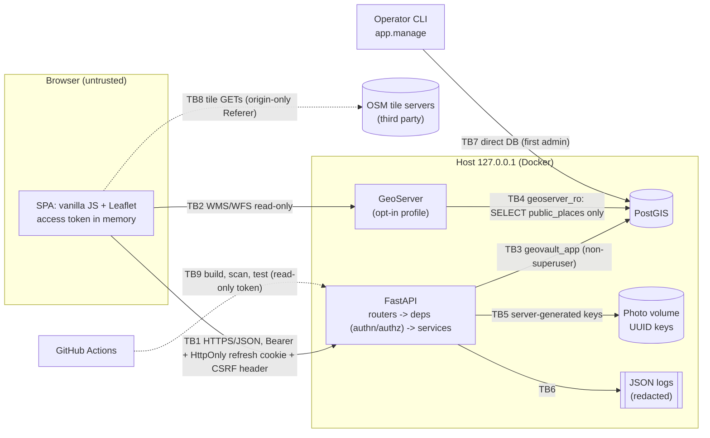

# GeoVault threat model (STRIDE)

| | |
|---|---|
| System | GeoVault secure mode, as built at milestone 12 (commit `020c9c6`) |
| Method | STRIDE per element over a data-flow diagram; OWASP API Security Top 10 (2023) mapping |
| Status | Living document. Every control listed is implemented **and** has a named automated test unless marked otherwise |
| Out of scope here | Lab mode (milestone 11, developer-implemented; it deliberately removes controls listed below), AWS deployment (project 2; separate cloud threat model) |

## 1. What we are protecting

| Asset | Sensitivity | Why it matters |
|---|---|---|
| **Exact favourite coordinates** | Critical | A saved "Home" or "Work" pin is precise location data. Disclosure enables stalking. |
| **Private notes** | High | Free text, often personal ("gate code 4471"). |
| **Photos** | High | Image content, and EXIF GPS in the original file. |
| **Credentials:** password hashes, access and refresh tokens, share-link tokens | Critical | Account takeover, or impersonating a share recipient. |
| **Account identity:** email, display name | Medium | Personal information; also an enumeration target. |
| **Authorization state:** roles, share grants | High | Privilege escalation, or silent loss of a revocation. |
| **Audit log:** actions, IPs, user agents | Medium | Security evidence, and personal data in its own right. |
| **Signing and infrastructure secrets:** `GEOVAULT_JWT_SECRET`, DB passwords, GeoServer admin password | Critical | Forging any token, or reaching the database directly. |
| **Public places dataset** | Low (integrity: Medium) | Public anyway, but tampering would mislead users and break licence attribution. |

## 2. Who might attack it

| Actor | Capability | Typical goal |
|---|---|---|
| Anonymous internet user | Any HTTP request; holds whatever links it found | Enumerate accounts, brute-force logins, scrape the API |
| Authenticated user | Valid account and tokens | Read or modify **other users'** boxes (BOLA), escalate to admin |
| Share recipient or link holder | One legitimate key | Recover the **exact** location behind a cloaked share |
| Script injected in the browser (XSS) | Runs in a user's page | Steal tokens, act as the user |
| Insider or administrator | Admin role, or operator shell | Over-reach: read private data, erase evidence |
| Database snapshot thief | A copy of the DB (backup leak) | Reuse tokens, crack passwords, read private data |
| Supply-chain attacker | Compromised dependency, image or CI action | Execute code in the build or the runtime |
| GIS client of GeoServer | WMS/WFS requests | Reach non-public layers or tables |

## 3. Data flow and trust boundaries

| Boundary | Crossing | Primary controls |
|---|---|---|
| TB1 | Browser → API | JWT validation, ownership/role dependencies, input schemas (`extra="forbid"`), rate limits, security headers, CSRF on cookie endpoints |
| TB2 | Browser/GIS → GeoServer | One published layer, read-only WFS, mandatory admin password, 127.0.0.1 bind |
| TB3 | API → DB | Bound parameters only, least-privilege role, statement timeout, DB constraints/triggers |
| TB4 | GeoServer → DB | `geoserver_ro`: SELECT on one view, read-only transactions |
| TB5 | API → photo store | Re-encoded images only, UUID keys, path containment |
| TB6 | API → logs | Central redaction, no query strings, request IDs |
| TB7 | Operator → DB | Requires host/container access; audited (`admin.bootstrap_promote`) |
| TB8 | Browser → OSM | Images only (CSP `img-src`), origin-only Referer; never tested or scanned |
| TB9 | CI → artefacts | SHA-pinned actions, digest-pinned scanners, `contents: read` token |

## 4. Attack surface

| Area | Entry points | Auth |
|---|---|---|
| Public data | `GET /api/health, /regions, /sources, /categories, /places, /places/near, /places/{id}` | none |
| Authentication | `POST /api/auth/register, /login, /refresh, /logout` | none / refresh cookie + CSRF |
| Account | `GET/PATCH/DELETE /api/users/me`, `GET /api/users/me/export` | bearer |
| Favourites | `GET/POST /api/favourites`, `GET/PATCH/DELETE /api/favourites/{id}`, `/cloak-preview`, `/public` | bearer + ownership |
| Sharing | `POST /api/favourites/{id}/share`, `GET /api/favourites/{id}/shares`, `DELETE …/shares/{share_id}` | bearer + ownership |
| Shared views | `GET /api/shared/{token}`, `/api/shared/{token}/photo`, `GET /api/shared/with-me`, `…/with-me/{share_id}/photo` | link token / bearer |
| Photos | `POST/GET/DELETE /api/favourites/{id}/photo` (multipart) | bearer + ownership |
| Admin | `GET /api/admin/users`, `PATCH /api/admin/users/{id}/role`, `GET /api/admin/audit` | bearer + admin (router-level) |
| Static UI | `/`, `/js/*`, `/vendor/*`, `/icons.svg`; `/docs` only when `env=local` | none |
| GeoServer | `/geoserver/ows` (WMS, WFS), `/geoserver/rest` | none / admin |
| Operator | `python -m app.manage promote-admin` | host access |

## 5. STRIDE per element

### 5.1 Browser ↔ API (TB1)

| | Threat | Control | Verified by |
|---|---|---|---|
| **S** | Forged or replayed access token | HS256 pinned; `exp/nbf/iat/iss/aud/sub/typ` required; weak secrets refused at start-up | `test_rejects_alg_none_token`, `test_rejects_token_signed_with_other_key`, `test_rejects_invalid_claims_even_with_valid_signature`, `test_weak_jwt_secrets_refuse_to_start` |
| **S** | Stolen refresh token reused | Hashed storage, rotation on every use, family revocation on reuse | `test_refresh_rotates_token`, `test_refresh_token_reuse_revokes_whole_family`, `test_refresh_tokens_are_stored_hashed` |
| **S** | Credential stuffing / brute force | Per-account and per-IP limits; breached-password list; Argon2id | `test_login_rate_limited_per_account`, `test_password_policy`, `test_argon2id_hash_and_verify` |
| **S** | Cross-site request on cookie endpoints | SameSite=Strict, `__Host-` CSRF cookie, double-submit header | `test_refresh_requires_csrf_header`, `test_logout_requires_csrf`, `test_login_sets_hardened_cookies` |
| **T** | Mass assignment (`role`, `owner_id`, `region`, `email`) | `extra="forbid"` on every input model; region derived server-side | `test_register_rejects_extra_fields_mass_assignment`, `test_update_rejects_protected_or_invalid_fields`, `test_create_validation` |
| **T** | SQL injection through query parameters | Static SQL with bound parameters; allowlisted identifiers for dynamic `UPDATE`; ruff `S608` | `test_sql_injection_payloads_are_inert`, `test_like_wildcards_are_literal`, `test_audit_filter_rejects_injection_shaped_input` |
| **R** | User denies having shared, deleted, changed a role | Audit events with actor, target, IP and user agent; admins' reads of the audit log are audited too | `test_auth_events_are_audited_without_secrets`, `test_role_change_takes_effect_immediately_and_is_audited`, `test_audit_view_filters_and_is_itself_audited` |
| **I** | BOLA: reading someone else's favourite | `get_owned_favourite` on every route; 404 identical for foreign and missing ids | `test_bola_other_users_favourite_is_404`, `test_bola_nonexistent_and_foreign_ids_are_indistinguishable`, `test_other_users_cannot_touch_photo` |
| **I** | Account enumeration | Generic login errors, dummy Argon2 verify, identical 202 on register | `test_login_failure_is_generic`, `test_unknown_email_still_runs_argon2`, `test_duplicate_registration_is_indistinguishable` |
| **I** | Excessive data exposure in shared/public views | Separate output schemas with no exact-coordinate, note or email field; SQL-side cloaking | `test_link_share_shows_only_cloaked_minimal_data`, `test_shared_view_never_reveals_linked_place`, `test_public_list_shows_only_public_favourites_cloaked` |
| **I** | Secrets echoed in errors | 422 handler drops submitted input; generic 500 with request ID | `test_password_policy` (password not echoed), `test_unhandled_errors_are_generic_and_logged_safely` |
| **I** | Cached personal responses | `Cache-Control: no-store` on all `/api/*` | `test_api_responses_default_to_no_store` |
| **D** | Unbounded queries, huge uploads, decompression bombs | Radius/limit/offset/length caps, statement timeout, `UploadGuard` before parsing, pixel limit before decode, per-user caps | `test_input_validation_rejects`, `test_oversized_declared_length_never_reaches_app`, `test_decompression_bomb_rejected_before_decoding`, `test_per_user_favourite_cap`, `test_share_creation_is_rate_limited` |
| **E** | Ordinary user reaches admin functions | Router-level `require_admin` reading the role from the DB, not the token | `test_admin_routes_reject_ordinary_users`, `test_every_admin_route_is_protected`, `test_role_claim_in_token_is_ignored` |
| **E** | Admin lock-out or self-escalation games | No self role change; last admin cannot delete themselves | `test_admin_cannot_change_own_role`, `test_last_admin_cannot_delete_account` |

### 5.2 Browser (client side)

| | Threat | Control | Verified by |
|---|---|---|---|
| **T/E** | Stored XSS via place names, labels, notes | `textContent`-only DOM; no `innerHTML`/`eval`; strict CSP with no inline code | `test_no_dangerous_dom_sinks`, `test_no_inline_scripts_styles_or_handlers`, `test_security_headers_on_every_response` |
| **I** | Token theft by XSS | Access token in memory only (never `localStorage`); refresh token HttpOnly | `test_no_dangerous_dom_sinks` (storage check), `test_login_sets_hardened_cookies` |
| **T** | Tampered third-party script | Leaflet vendored with SRI; fonts self-hosted | `test_vendored_leaflet_matches_sri_hashes`, `test_self_hosted_fonts_ship_with_licences` |
| **I** | Share token leaked via logs or Referer | Token in URL fragment (`#/share/…`); `Referrer-Policy: no-referrer` on share routes; tokens redacted in logs | `test_link_share_shows_only_cloaked_minimal_data` (no-referrer), `test_logs_never_contain_secrets_or_locations` |
| **S** | Clickjacking | `frame-ancestors 'none'`, `X-Frame-Options: DENY` | `test_security_headers_on_every_response` |

### 5.3 API ↔ database (TB3)

| | Threat | Control | Verified by |
|---|---|---|---|
| **E** | Injection escalates to the OS or file system | App role is not a superuser and cannot read server files | `test_app_role_is_least_privilege`, `test_app_role_cannot_read_server_files` |
| **T** | Application bug writes invalid or unsafe rows | Constraints and triggers: Argon2id-only hashes, one-target shares, links must expire, EXIF-stripped photos, UUID storage keys, region bounds | `test_user_password_must_be_argon2id`, `test_share_needs_exactly_one_target`, `test_link_share_must_expire`, `test_photo_must_be_exif_stripped_with_server_key`, `test_trigger_rejects_place_outside_its_region` |
| **I** | DB snapshot leak exposes reusable secrets | Refresh and share tokens stored as SHA-256; passwords as Argon2id | `test_refresh_tokens_are_stored_hashed`, `test_link_token_is_shown_once_and_stored_hashed`, `test_hashes_are_salted` |
| **T** | Malicious migration file | Runner accepts only `NNNN_name.sql` | `test_migration_runner_rejects_unexpected_file_names` |

### 5.4 GeoServer (TB2, TB4)

| | Threat | Control | Verified by |
|---|---|---|---|
| **I** | Private tables published as layers | `geoserver_ro` can SELECT only `public_places`; even an admin-published `favourites` layer returns no data | `test_cannot_read_any_other_table`, `test_only_grant_is_select_on_the_view`; `geoserver/verify.py` (16 checks) |
| **T** | WFS-T edits public data | WFS service level BASIC; DB role read-only | `test_every_transaction_is_read_only`; `verify.py` "WFS Transaction rejected" |
| **S** | Default `admin/geoserver` | Password mandatory via compose; default rejected | `verify.py` "default admin/geoserver rejected" |

### 5.5 Photo store (TB5)

| | Threat | Control | Verified by |
|---|---|---|---|
| **I** | GPS/EXIF location leaks through photos | Pixels rebuilt into a fresh image; orientation applied first | `test_upload_strips_gps_end_to_end`, `test_jpeg_gps_and_camera_metadata_removed`, `test_png_text_and_xmp_chunks_removed_alpha_kept` |
| **T/E** | Path traversal, polyglots, SVG/HTML upload (stored XSS) | Format decided by decoding; UUID keys with containment checks; `nosniff` + sandbox CSP on delivery | `test_declared_content_type_and_filename_are_ignored`, `test_rejects_non_images_and_bombs`, `test_safe_delivery_headers`, `test_photo_storage_key_cannot_be_a_path` |
| **I** | Orphaned files after deletion | Files deleted with photo, box and account | `test_deleting_favourite_removes_file`, `test_deleting_account_removes_files`, `test_reupload_replaces_and_deletes_old_file` |

### 5.6 Logs (TB6)

| | Threat | Control | Verified by |
|---|---|---|---|
| **I** | Tokens, passwords, emails, coordinates written to logs | Central redaction of every string; access log without query strings | `test_redacts_secrets_and_personal_data`, `test_logs_never_contain_secrets_or_locations` |
| **R** | Requests cannot be correlated | Validated `X-Request-ID` in every log line and response | `test_request_id_generated_or_safely_propagated` |

### 5.7 Supply chain (TB9)

| | Threat | Control | Verified by |
|---|---|---|---|
| **T** | Vulnerable or tampered dependency or image | Fully pinned Python deps, digest-pinned base images, Debian security updates at build, Dependabot | CI: `pip-audit --strict`, Trivy image scan (fixable HIGH/CRITICAL fail) |
| **T** | Malicious CI action | Actions pinned to commit SHAs; scanners pinned by digest; read-only token | CI workflow review |
| **I** | Committed secrets | Gitleaks over full history in CI and pre-commit | CI `secrets` job, pre-commit hook |
| **T** | Tampered open-data snapshot | SHA-256 manifest verified before import | `test_tampered_snapshot_is_refused_and_db_untouched`, `test_committed_snapshots_match_manifest` |

## 6. Abuse cases

| ID | Story | Outcome in secure mode |
|---|---|---|
| AC-1 | A stalker with a share link wants the victim's exact home. | Gets the centre of a 100 m–1 km cell. Repeat requests return the same point, so averaging fails. The linked public place is never revealed (`test_cloaking_is_deterministic_and_grid_aligned`, `test_shared_view_never_reveals_linked_place`). **Residual:** see R-1, R-2. |
| AC-2 | A curious user iterates favourite UUIDs. | Every foreign id returns the same 404 as a missing one. No existence oracle. |
| AC-3 | A user edits their profile with `{"role":"admin"}`. | 422. The role is unchanged. |
| AC-4 | An attacker steals a refresh cookie and races the victim. | The first reuse of a rotated token revokes the whole family. Both sessions end and the event is audited. |
| AC-5 | An attacker uploads a photo with GPS tags, or an SVG with script. | GPS gone from the stored file; SVG rejected (422) and the rejection is audited. |
| AC-6 | A GIS user requests the `favourites` layer from GeoServer. | `ExceptionReport`. Even if an admin published it, the DB returns nothing. |
| AC-7 | An admin wants to read someone's private box. | No API path returns another user's exact coordinates or notes, admins included. Admins see accounts, roles and the audit log only. |
| AC-8 | Someone tries to enumerate emails through registration, login or the share dialog. | Registration and login are indistinguishable. **Residual:** see R-3. |

## 7. OWASP API Security Top 10 (2023) coverage

| Risk | GeoVault control | Key tests |
|---|---|---|
| API1 BOLA | `get_owned_favourite`, share scoping | `test_bola_*`, `test_recipient_photo_access_is_scoped_to_their_share` |
| API2 Broken authentication | Argon2id, rate limits, JWT validation, refresh rotation | `test_auth.py` |
| API3 Broken object property level authorization | `extra="forbid"`; minimal output schemas | `test_update_rejects_protected_or_invalid_fields`, `test_link_share_shows_only_cloaked_minimal_data` |
| API4 Unrestricted resource consumption | Caps, timeouts, `UploadGuard`, pixel limit, rate limits | `test_input_validation_rejects`, `test_upload_guard.py` |
| API5 Broken function level authorization | Router-level `require_admin` | `test_admin.py` |
| API6 Unrestricted access to sensitive business flows | Share-creation and registration rate limits; deletion needs re-auth | `test_share_creation_is_rate_limited`, `test_delete_requires_correct_password` |
| API7 Server-side request forgery | No user-supplied URL is ever fetched server-side. Data snapshots are operator-run and HTTPS-only | Design review (no SSRF sink) |
| API8 Security misconfiguration | Headers, CSP, no CORS, no banner, docs off in production, generic errors | `test_hardening.py` |
| API9 Improper inventory management | One router per area, no versioned or legacy routes, OpenAPI docs local-only | `test_docs_disabled_in_production`; route inventory in §4 |
| API10 Unsafe consumption of APIs | Third-party data imported only from hash-verified snapshots, validated per feature | `test_import.py`, `test_sources.py` |

## 8. Residual risks (accepted, with rationale)

| ID | Risk | Why accepted / mitigation path |
|---|---|---|
| R-1 | Cell membership: the true spot lies inside a known cell | Inherent to cloaking. Precision is the owner's choice. Quantified in the re-identification experiment (project 3). |
| R-2 | Sharing one place at several precisions narrows it to the finest cell | Documented in `docs/privacy/location-precision.md`. A future UI could warn on re-share at a finer precision. |
| R-3 | User-share by email reveals whether an account exists to an **authenticated** user | Rate-limited per user (30/h) and audited. Fixing it needs an invitation flow, which needs email. |
| R-4 | XSS could use the in-memory access token while the page is open | Defence in depth: textContent-only DOM, strict CSP, 15-minute tokens. |
| R-5 | In-process rate limiter resets on restart and is per process | Correct for one worker. Move to a shared store before scaling horizontally (noted in code). |
| R-6 | No email verification at registration | Out of scope (no mail service). Registration reveals nothing either way. |
| R-7 | Local deployment is plain HTTP on 127.0.0.1 | Loopback only. HTTPS and HSTS are mandatory in the AWS deployment (project 2). |
| R-8 | Photo content (not metadata) can reveal a location | Cannot be solved technically. Users are told photos are visible to recipients. |
| R-9 | Audit log stores IP addresses | Needed for security investigations. Bounded by the retention job (project 3). |

## 9. Assumptions

- The host running Docker is trusted. Anyone with Docker or DB-superuser access is an operator.
- Cryptographic primitives (Argon2id, SHA-256, HS256) behave as specified, and secrets in `.env`
  are random and private.
- Public open data is public. Its integrity matters, its confidentiality does not.
- Lab mode (milestone 11) is a separate, localhost-only build. Its deliberately missing controls
  are catalogued in `docs/lab-vulnerabilities.md` once it exists, not here.
